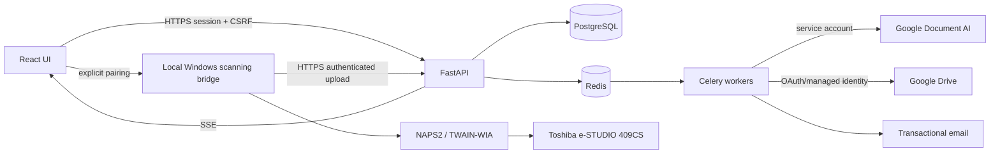

# Architecture — deployable modular monolith



## Repository shape
```
apps/web/                  React + TS + Vite (frontend)
apps/api/                  FastAPI, schemas, auth, route adapters
apps/worker/               Celery tasks and outbox dispatch
packages/contracts/        OpenAPI-generated TS bindings
packages/ui/               component design system
migrations/                Alembic migrations
tests/unit|integration|e2e/ pytest, Playwright, concurrent load
scanner-bridge/            separate Windows app, independently versioned
docs/                      this pack and decisions
infra/                     Docker, monitoring, backup automation
```

## Bounded modules (single deploy for API)
identity, catalogs, pricing, sales_orders, picking, invoicing, inventory, purchasing/receiving, documents, scanner_ingest, OCR_review, payments/manual_receivables, analytics, migration, notifications/audit.

## Cross-cutting patterns
- Pydantic validated typed payloads, OpenAPI contract; SQLAlchemy 2.x sessions and Alembic migrations; PostgreSQL `NUMERIC` for money and measurements.
- API creates DB record + outbox event transactionally. Background workers create PDFs, process OCR, sync Drive, email notices. External side effects **never** run inside stock posting transaction.
- SSE carries resource IDs and versions (`stock.changed`, `invoice.issued`); UI refetches server authority. Never trust SSE as financial truth.
- Single tenant internal installation at V1; every resource scoped to company/warehouse as appropriate. Prepare for multi-warehouse but avoid speculative multi-tenant SaaS architecture.
- Versioned JSON response envelopes, stable reference IDs, UTC timestamps stored with zone-aware display in America/Toronto, fiscal-effective dates explicitly local.
- Use conventional route-level pagination/filter schemas and cursor where needed; database indexes on created_at, product, customer, vendor, order and company.
- Architecture decision records in `docs/decisions/`; changes require migration and test impacts documented.

## Development environments
Local Docker compose for PostgreSQL/Redis/API/worker; Windows office bridge kept separate and only tested on hardware. Staging has isolated DB and fake payments/synthetic documents. Production secrets rotated, TLS proxy, least privilege, offsite restores.
