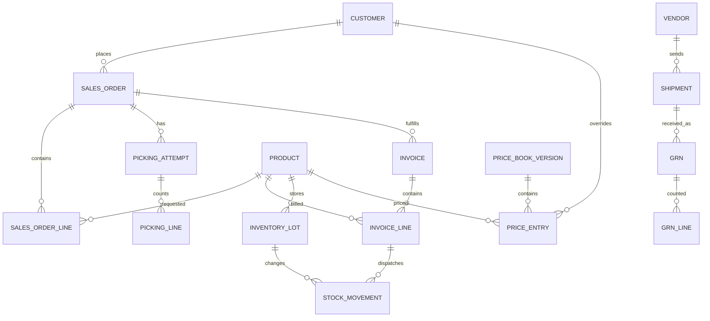

# Data design and transaction correctness

## Core entity map


## Table design
See `db/schema.sql` for types, keys, indexes and sample constraints. Distinguish document metadata, uploaded original immutable bytes, OCR review results, and approved records. Every business table uses stable UUID, created_at, updated_at, optional optimistic `version`; every posting ledger row immutable.

## Safe invoice issuance pseudocode
```
BEGIN;
  authorize current user for issue invoice and source warehouse;
  INSERT INTO idempotency_records(scope, key, request_hash, status='in_progress')
    ON CONFLICT ...; check existing hash + outcome;
  SELECT order/pick attempt FOR UPDATE;
  verify pick is human-approved and remaining_qty permits this shipment;
  SELECT inventory_balance rows FOR UPDATE in stable product/lot order;
  verify available stock (unless permitted manager adjustment);
  lock invoice number counter, assign next invoice number;
  INSERT invoice+invoice_lines, immutable price and tax snapshots;
  INSERT stock_movements with UNIQUE source keys;
  UPDATE balances from recorded movements;
  UPDATE sales_order_line dispatched totals, pick state;
  INSERT audit_events + outbox_events;
  mark idempotency outcome committed;
COMMIT;
Async: PDF -> Drive -> email, retryable and visible in UI.
```

No external API inside transaction. To avoid crash-between-commit-and-response duplication, return saved result on retry with same key. If request hash differs under same key, return 409. Lock item rows sorted by product+lot to reduce deadlock; retry SQL serialization/deadlock failures a bounded number of times, with jitter. PostgreSQL row-level locking and unique constraints are part of design, not only app-level checks.

## Inventory and cost
- `stock_movements`: signed quantity (normalized unit), type, source tuple, lot/warehouse, actor, unique posting key and optional reversal reference.
- `inventory_balances`: cached/locked count by product/lot/warehouse/base unit. Can recompute from movements; reconcile nightly. Store boxes and physical lb as **separate measures** when relevant; no implicit assumption a box always weighs 40 lb.
- Perishable batches: received on date, source shipment/lot, expiry/best-before when present, country, landed-cost basis, stock status (saleable/damaged).
- COGS methodology is **open decision** (FIFO / weighted average / batch actual) — dashboards must label gross margin unavailable until cost basis approved and reconciliation passes.
- Monetary amounts in integer minor units or PostgreSQL NUMERIC with Decimal in Python, rounding at defined legally correct stages. Do not use JS float arithmetic for authoritative totals.

## Versioning and documents
- `price_book_versions` immutable activation sets; `price_entries` include scope (standard/group/customer) and unit, effective timestamp. Pricing precedence customer > group > base, conflict resolution deterministic. Invoice line captures price source and currency.
- `documents` distinguish original scan, pick scan, shipping docs, vendor invoices, PDFs, signed POD and archived revision. Drive file ID and sync state separately, with retries.
- `audit_events` append-only, server generated; include actor, action, target, request ID and before/after key fields (redact secrets). Store failures (auth denied/OCR failed), protect logs from routine admin edits.

## Critical DB tests
1. 10 concurrent identical invoice finalizations -> one issued invoice, one stock posting set.
2. 10 simultaneous different invoices compete for last stock -> no oversell.
3. Retry same request 100 times -> same response/IDs, no duplicate ledger.
4. One order 15 boxes -> invoice 10, next day invoice 5 -> remaining zero, stock total -15.
5. Same product weight rows 2x20 + 2x30 + 2x40 + 1x25 -> 7 boxes/205lb, not a new SKU for each case size.
6. GRN duplicated scan/import, approve twice -> +N only once.
7. Price change after issue -> issued invoice rate unchanged.
8. Simulate rollback from failure during issue -> neither invoice nor stock movement remains.
